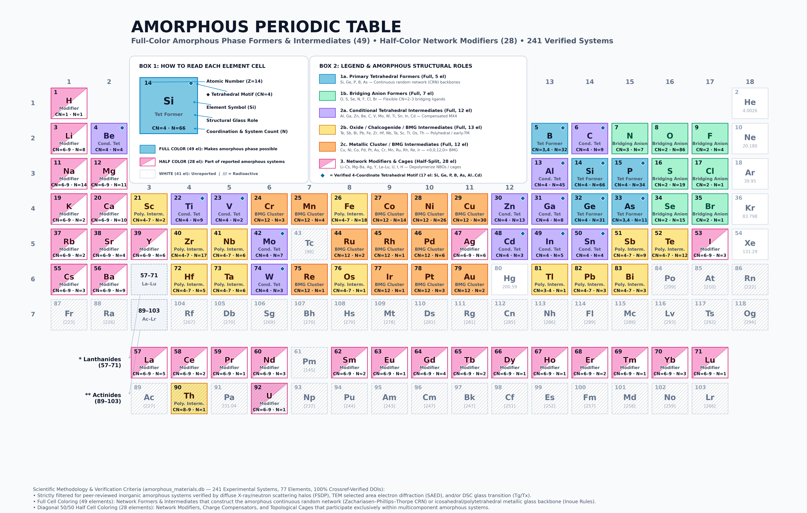

# Interactive Amorphous Periodic Table

[](https://btemuujin.github.io/Amorphous_periodic_table/)
[](https://www.python.org/)
[](LICENSE)

> 🚀 **Live Interactive Web Application**: [https://btemuujin.github.io/Amorphous_periodic_table/](https://btemuujin.github.io/Amorphous_periodic_table/)

---

## Overview

A publication-grade scientific periodic table visualization and interactive web application that classifies all **118 chemical elements** ($Z = 1\text{--}118$) by their role in forming **inorganic amorphous solids and glasses**, backed by **241 experimentally verified amorphous systems** across **77 active elements**:
- **Mutually Exclusive 6-Group Structural Partition**: Distinguishes **49 framework-forming / polyhedral intermediate elements** (*"Makes Amorphous Phase Possible"*, full cell coloring) from **28 modifier / charge-compensator / cage elements** (*"Part of Reported Amorphous Systems"*, diagonal 50/50 half-split cell coloring) and **41 uncolored elements** with zero verified inorganic amorphous phases.
- **Four Inorganic Glass Families**: **Oxides** (91 systems), **Chalcogenides** (47 systems), **Metallic Glasses** (73 systems), and **Covalent Networks / Halide Glasses** (30 systems).
- **Three Thermodynamic & Kinetic Synthesis Regimes**: **Bulk Melt-Quenched Glasses & BMGs** (152 systems, $R_c \sim 10^{-2}\text{--}10^3\text{ K/s}$), **Rapid-Quenched Melt-Spun Ribbons & Levitated Melts** (31 systems, $R_c \sim 10^4\text{--}10^6\text{ K/s}$), and **Vapor-Deposited / Thin-Film Amorphous Solids** (58 systems, $R_{c,\text{eff}} > 10^8\text{ K/s}$).
- **Short- and Medium-Range Order (SRO / MRO) Characterization**: First Sharp Diffraction Peak $S(Q)$, pair distribution function $g(r)$, bond-angle distribution $P(\theta)$, coordination numbers, ring statistics / Voronoi polyhedra, and crystalline-to-amorphous conversion pathways.

Built upon foundational glass science frameworks by **W. H. Zachariasen** (*J. Am. Chem. Soc.*, 1932), **K.-H. Sun** (*J. Am. Ceram. Soc.*, 1947), **J. C. Phillips** (*J. Non-Cryst. Solids*, 1979), **A. Inoue** (*Acta Mater.*, 2000), **D. B. Miracle** (*Nat. Mater.*, 2004), and **F. Hellman** (*Rev. Mod. Phys.*, 2017).

---

## Preview

### 1. Static Publication-Grade Periodic Table (300 DPI)

The high-resolution master reference poster (`amorphous_periodic_table.png`, print-ready 300 DPI) displays all 118 elements arranged in an 18-column IUPAC format with separated Lanthanides and Actinides, structural role color coding, diagonal 50/50 modifier split rendering, verified system counts ($N$), tetrahedral coordination badges (`[Tet]`), synthesis regime markers (`[TF]`, `[RQ]`), and a detailed visual legend.

[](amorphous_periodic_table.png)

---

### 2. A Glance at the Live Interactive Application

The interactive web application runs in any modern browser with zero server dependencies (fully self-contained `index.html`, Zero-CORS offline execution). It provides real-time synthesis regime and structural role filters, chemical system & DOI search, interactive co-occurrence highlighting, and a 5-tab element inspection modal featuring an **interactive 3D WebGL local coordination & network polyhedra viewer**.

> 🌐 **Launch the Live Application**: [https://btemuujin.github.io/Amorphous_periodic_table/](https://btemuujin.github.io/Amorphous_periodic_table/)

**Interactive Highlights at a Glance:**
- **Dynamic Multi-Criteria Filtering**: Filter simultaneously by **Synthesis Regime** (*All 241 Systems*, *Bulk Melt-Quenched 152*, *Rapid-Quenched 31*, *Vapor / Thin-Film 58*), **Structural Role Group** (Groups 1a, 1b, 2a, 2b, 2c, 3), or **4-Coordinate Tetrahedral Capability**.
- **Interactive 3D Local Coordination Viewer (Three.js WebGL)**: Renders element-specific short-range polyhedra (corner-sharing tetrahedra, trigonal planar $\text{BO}_3$, icosahedral $\langle 0,0,12,0\rangle$ clusters, bicapped square antiprisms, and modifier cages) with interactive rotation and zoom.
- **5-Tab Deep Scientific Drawer**:
  1. **Overview & 3D Local Coordination** (Composite Amorphous Score $S_i$, role badges, and 3D polyhedral geometry)
  2. **Verified Amorphous Systems (`amorphous_materials.db`)** (clickable DOIs, paper titles, glass families, $T_g$/$T_x$, and characterization techniques)
  3. **Co-Occurrence & Correlation Metrics** (Pearson $\phi$, stoichiometric $r$, Normalized Mutual Information, and shared systems)
  4. **Glass-Forming Mechanism, Conversion Benchmarks & Atomic/Crystalline Reference**
  5. **Diffraction $S(Q)$, Radial/Partial Distribution $g(r)$, Bond Angles $P(\theta)$ & Ring/Voronoi Topology**

---

## Amorphous Classification & Visual Legend

| Structural Role Group | Count | Cell Style | Criteria & Representative Elements | Cell Swatch |
| :--- | :---: | :---: | :--- | :---: |
| **1a. Primary Tetrahedral Network Former** | 5 | Full Color | Open 3D $sp^3$ / $d^0$ corner-sharing tetrahedral framework ($N_{\text{coord}} \approx 4$): **Si**, **Ge**, **P**, **B**, **As** | Deep Blue (`#1D4ED8`) |
| **1b. Bridging Anion Network Former** | 7 | Full Color | Flexible two- or three-coordinate bridging anions linking network polyhedra: **O**, **S**, **Se**, **N**, **F**, **Cl**, **Br** | Sky Blue (`#0284C7`) |
| **2a. Conditional Tetrahedral Intermediate** | 12 | Full Color | Adopts 4-coordinate tetrahedral network sites with charge compensation or vapor quenching: **Al**, **Ga**, **Zn**, **Be**, **C**, **V**, **Mo**, **W**, **Ti**, **Sn**, **In**, **Cd** | Teal (`#0D9488`) |
| **2b. Oxide / Chalcogenide / BMG Polyhedral Intermediate** | 13 | Full Color | High-field-strength or lone-pair cations forming $\text{MO}_5$/$\text{MO}_6$ or early-TM BMG backbones: **Te**, **Sb**, **Bi**, **Pb**, **Fe**, **Zr**, **Hf**, **Nb**, **Ta**, **Sc**, **Tl**, **Os**, **Th** | Amber (`#D97706`) |
| **2c. Metallic Cluster / BMG Host Intermediate** | 12 | Full Color | Late/mid-transition metals forming solute-centered Kasper/icosahedral clusters in metallic glasses: **Cu**, **Ni**, **Co**, **Pd**, **Pt**, **Au**, **Cr**, **Mn**, **Ru**, **Rh**, **Re**, **Ir** | Purple (`#7C3AED`) |
| **3. Network Modifier / Charge Compensator / Cage** | 28 | Diagonal 50/50 Split | Depolymerizes networks (creates NBOs) or stabilizes topological packing cages: **Li–Cs**, **Mg–Ba**, **Ag**, **Y**, **La–Lu**, **U**, **I**, **H** | Rose (`#E11D48`) / White |
| **Uncolored (No Verified Amorphous Phase)** | 41 | White | Zero verified inorganic amorphous systems in `amorphous_materials.db` (noble gases, transuranics, $\text{Tc}$, $\text{Pm}$, etc.) | White (`#FFFFFF`) |

---

## Scientific Rigor & Provenance

- **100% Crossref & OpenAlex Verified Citations (`data/verified_doi_registry.json`)**:
  Every cataloged amorphous system and crystalline-to-amorphous conversion benchmark resolves to a live peer-reviewed DOI (`HTTP 200 OK`, verified author/year/journal/title match) and is experimentally confirmed by diffuse X-ray/neutron scattering ($S(Q)$ First Sharp Diffraction Peak), pair distribution function $g(r)$, TEM selected-area electron diffraction (SAED), and/or differential scanning calorimetry ($T_g$ / $T_x$).
- **Explicit Experimental vs. Reconstructed Spectral Provenance**:
  In Tab 5 ($S(Q)$, $g(r)$, and $P(\theta)$ curves), the interface explicitly badges whether curves are anchored to **Literature Experimental / MD Benchmark Peaks** (43 canonical systems such as $\text{SiO}_2$, $\text{GeSe}_2$, $\text{Zr}_{41.2}\text{Ti}_{13.8}\text{Cu}_{12.5}\text{Ni}_{10}\text{Be}_{22.5}$, $\text{Cu}_{50}\text{Zr}_{50}$, $a\text{-Si}$, $a\text{-Gd}_{14}\text{Si}_{86}$) or **Composition-Weighted Analytical Reconstructions** (198 multi-component systems reconstructed from covalent/metallic radii and family FSDP/coordination rules).
- **Composite Amorphous Induction Score ($S_i$)**:
  Combines frequency coverage ($f_i$), compositional diversity / normalized Shannon partner entropy ($H_i$), majority-species dominance ($D_i$), and Zachariasen/Miracle structural topology bonus ($Z_i$):
  $$S_i = 0.30 f_i + 0.25 H_i + 0.20 D_i + 0.25 Z_i$$

---

## Quick Start

### 1. Run the 6-Step Pipeline

```bash
python3 run_pipeline.py --skip-online
```

This executes all six deterministic stages:
1. **`src/step1_retrieve_literature.py`** — Compiles curated amorphous material records (`data/raw_amorphous_records.json`).
2. **`src/step2_parse_normalize.py`** — Normalizes formulas to canonical IUPAC stoichiometry, filters out organic control glasses, flags 4-coordinate tetrahedral network formers, and computes SRO/MRO structural characterizations (`amorphous_systems.json`).
3. **`src/step3_ingest_sqlite.py`** — Ingests normalized records into `amorphous_materials.db` with indexed `materials` and `material_elements` tables.
4. **`src/step4_statistical_analysis.py`** — Computes elemental frequencies, co-occurrence matrix $C_{ij}$, Pearson $\phi$/$r$, Mutual Information, Shannon partner entropy $H_i$, and the Composite Amorphous Induction Score $S_i$ (`data/statistical_analysis_results.json`).
5. **`src/step5_generate_report.py`** — Exports the comprehensive analytical report (`amorphous_periodic_table_report.md`).
6. **`generate_amorphous_table.py` & `build_interactive_table.py`** — Builds the 118-element dataset (`data/amorphous_periodic_table_118.json`), renders the 300 DPI publication poster (`amorphous_periodic_table.png`), and compiles the interactive web application (`index.html`).

### 2. Run the Test Suite

```bash
python3 -m unittest discover -s tests -p "test_*.py" -v
```

### 3. Launch Interactive Web App Locally

```bash
# Option A: Standard library HTTP server
python3 -m http.server 8000
# Open http://localhost:8000 in your browser

# Option B: Direct zero-server offline viewing (embedded data, zero-CORS)
open index.html      # macOS
xdg-open index.html  # Linux
```

---

## Repository Structure

```text
Amorphous_periodic_table/
├── index.html                          # GitHub Pages root web application (self-contained, 3D WebGL)
├── amorphous_periodic_table.png        # 300 DPI publication-grade periodic table poster
├── amorphous_materials.db              # Indexed SQLite database (241 systems, 705 element rows)
├── amorphous_systems.json              # Normalized 241-system catalog with SRO/MRO profiles
├── build_interactive_table.py          # Self-contained interactive HTML compiler (generates index.html)
├── generate_amorphous_table.py         # 118-element JSON & 300 DPI Matplotlib poster generator
├── run_pipeline.py                     # End-to-end 6-step pipeline orchestrator
├── pyproject.toml                      # Python package & dependency metadata
├── README.md                           # Project documentation
├── data/
│   ├── amorphous_periodic_table_118.json
│   ├── baseline_elements_118.json
│   ├── raw_amorphous_records.json
│   ├── statistical_analysis_results.json
│   └── verified_doi_registry.json      # 100% Crossref & OpenAlex verified DOI audit registry
├── src/
│   ├── catalog_oxides_chalcogenides.py
│   ├── catalog_metals_covalent.py
│   ├── catalog_extended_systems.py
│   ├── step1_retrieve_literature.py
│   ├── step2_parse_normalize.py
│   ├── step3_ingest_sqlite.py
│   ├── step4_statistical_analysis.py
│   ├── step5_generate_report.py
│   ├── step6_build_periodic_table_data.py
│   ├── structural_characterization_data.py
│   ├── verify_and_resolve_dois.py
│   └── vpn_fulltext_extractor.py
└── tests/
    └── test_pipeline.py                # 11-test unit & end-to-end verification suite
```

---

## Core References

1. **Zachariasen, W. H.** (1932). *The Atomic Arrangement in Glass*. Journal of the American Chemical Society, 54(10), 3841–3851.
2. **Sun, K.-H.** (1947). *Fundamental Condition of Glass Formation*. Journal of the American Ceramic Society, 30(9), 277–281.
3. **Phillips, J. C.** (1979). *Topology of covalent non-crystalline solids I: Short-range order in chalcogenide alloys*. Journal of Non-Crystalline Solids, 34(2), 153–181.
4. **Inoue, A.** (2000). *Stabilization of metallic supercooled liquid and bulk amorphous alloys*. Acta Materialia, 48(1), 279–306.
5. **Miracle, D. B.** (2004). *A structural model for metallic glasses*. Nature Materials, 3(10), 697–702.
6. **Salmon, P. S., Martin, R. A., Mason, P. E., & Cuello, G. J.** (2005). *Topological versus chemical ordering in network glasses at intermediate and extended length scales*. Nature, 435(7038), 75–78.
7. **Sheng, H. W., Luo, W. K., Alamgir, F. M., Bai, J. M., & Ma, E.** (2006). *Atomic packing and short-to-medium-range order in metallic glasses*. Nature, 439(7075), 419–425.
8. **Hellman, F., et al.** (2017). *Interface-induced phenomena in magnetism*. Reviews of Modern Physics, 89(2), 025006.
